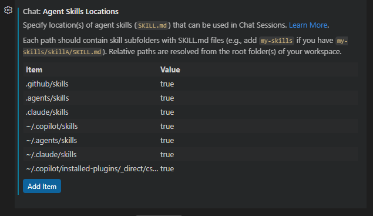

# AI-Plugins-And-Skills - VS Code Copilot

GitHub Copilot agent mode skill installation and usage guide for VS Code.

See [README.md](../README.md) for the full plugin and skill listing.

## Requirements

- **VS Code** v1.109+ (January 2026 release or later)
- **GitHub Copilot** extension with agent mode enabled
- `chat.useAgentSkills` setting enabled (on by default)

The skills' own scripts expect `git`, the .NET 10 SDK, pwsh 7 and, for `python-project`, Python 3.10+ with `uv`. The full list, with what needs each one, is in the [Claude Code prerequisites](README-CLAUDECODE.md#prerequisites).

## Installation

### Option A: VS Code Settings (Recommended)

Point VS Code at the skill directories in your local clone:

```bash
# Clone this repository
git clone https://github.com/darthmolen/ai-plugins-and-skills.git ai-plugins-and-skills
```

You can also configure this in the UI: Ctrl+Shift+P > **Chat: Chat Settings**, then search for `agentSkillsLocations`.



Or edit your VS Code **user** `settings.json` directly (Ctrl+Shift+P > "Preferences: Open User Settings (JSON)"):

```json
{
  "chat.agentSkillsLocations": [
    "C:/path/to/ai-plugins-and-skills/skills"
  ]
}
```

Replace `C:/path/to/` with the actual path to your clone.

Restart VS Code. Skills are now available in agent mode. Run `Chat: Configure Skills` (Ctrl+Shift+P) to verify they appear.

### Option B: Use Copilot CLI Plugin Directory

If you already installed the plugins via [Copilot CLI](README-COPILOT-CLI.md), point VS Code at the Copilot CLI installed skills directory. VS Code does not auto-discover skills from Copilot CLI's plugin path, so you need to tell it where to look.

Open Ctrl+Shift+P > **Chat: Chat Settings** > `agentSkillsLocations`, or add to your VS Code **user** `settings.json`:

```json
{
  "chat.agentSkillsLocations": [
    "~/.copilot/installed-plugins/_direct/ai-plugins-and-skills/skills"
  ]
}
```

You can also add a personal skills directory for any custom skills you create:

```json
{
  "chat.agentSkillsLocations": [
    "~/.copilot/installed-plugins/_direct/ai-plugins-and-skills/skills",
    "~/.copilot/skills"
  ]
}
```

Restart VS Code. Run `Chat: Configure Skills` (Ctrl+Shift+P) to verify they appear.

## Usage

### Skills

Skills activate automatically in Copilot agent mode when your prompt matches their description.

| Skill | Activates When |
|-------|---------------|
| `csharp-quality-developer` | Writing or reviewing C# code |
| `python-developer` | Writing Python application code |
| `plan-tier` | Starting a plan, or deciding how much detail it needs |
| `session-workflow` | Starting or ending an agent session in a repository other sessions may share |
| `codebase-mapper` | Mapping a codebase, generating architecture docs |
| `ace-fca-workflow` | Complex multi-file tasks in large codebases |

### Verifying Skills

Run `Chat: Configure Skills` from the command palette to see all discovered skills and their status.

## Updating

### Settings approach

Pull the latest changes -- VS Code picks them up on next restart:

```bash
cd ai-plugins-and-skills && git pull
```

### Copilot CLI approach

Update the plugin via Copilot CLI -- VS Code picks up the changes on next restart:

```bash
copilot plugin update ai-plugins-and-skills
```

## Current Limitations

### No Slash Commands

VS Code Copilot does not have a slash command system equivalent to Claude Code's. The `python-project` command in `commands/` is Claude Code only; ask for the `python-project` skill with `check` or `new` instead.

### No Agents or Hooks

The `wave-lead` and `wave-track` agents and the `wave-session-title` hook are Claude Code only. Start a wave role by invoking `wave-workflow` with `lead` or `track <name>`, and name the session `wave-<n>-lead` or `wave-<n>-<track>` by hand.

### No Plugin System

VS Code Copilot loads skills individually, not as plugin bundles. There is no marketplace install or plugin management -- skills are discovered from directories.